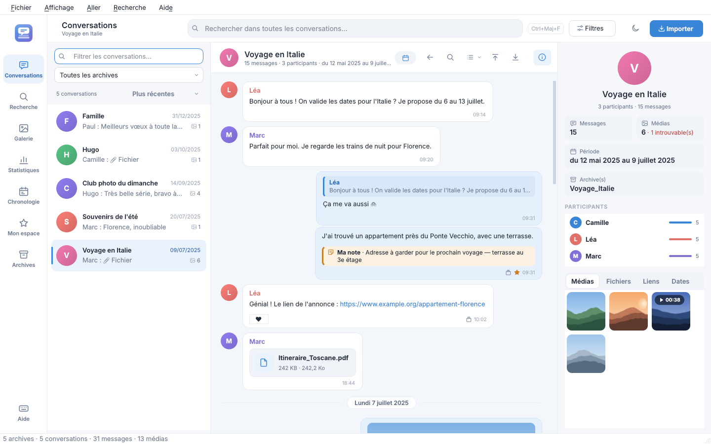
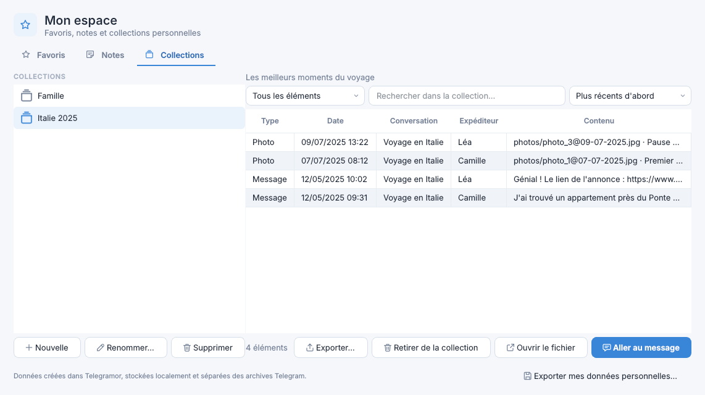
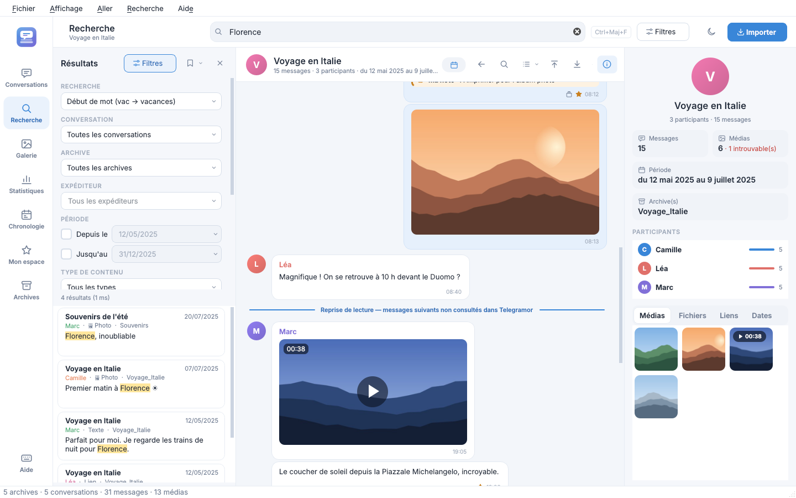
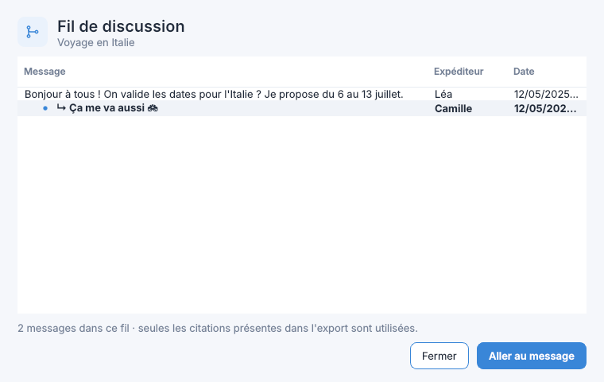
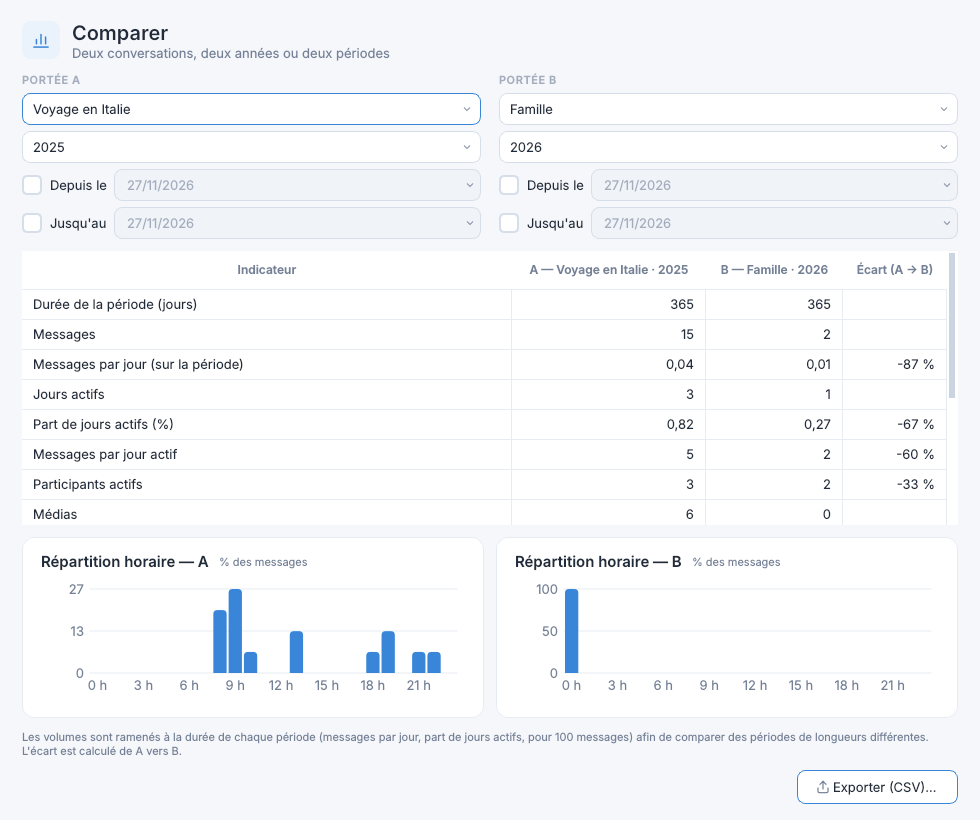
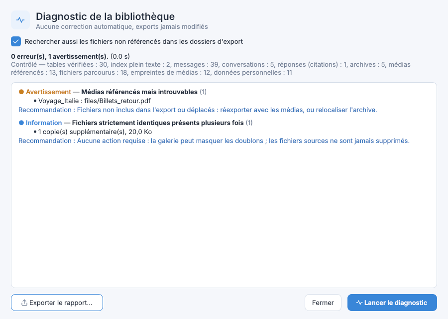
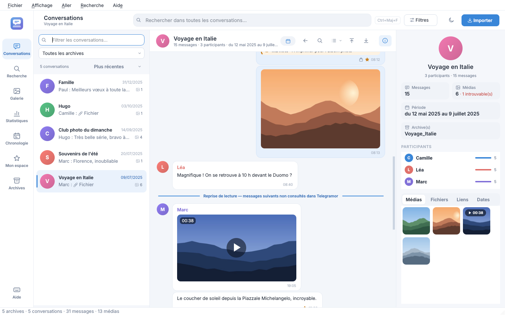

# Telegramor — Telegram Archive Explorer

Gestionnaire et explorateur **local** d'archives Telegram exportées en HTML
(Telegram Desktop), pour Debian 13 et les distributions dérivées.

- **Explorer** : conversations, recherche plein texte multicritère, galerie,
  chronologie, statistiques et comparaisons.
- **Organiser** : favoris, notes privées, collections, reprise de lecture,
  fils de discussion.
- **Valoriser** : export (HTML, PDF, Markdown, JSON), impression, copie de
  médias.
- **Fiabiliser** : diagnostic, détection des fichiers identiques, sauvegarde
  et restauration.

**Tout reste sur votre ordinateur** : aucun compte, aucun service en ligne,
aucune télémétrie.

> **Version 1.3** : données personnelles (favoris, notes, collections, lecture),
> fils de discussion, exports et impression, statistiques comparatives,
> diagnostic, fichiers identiques, sauvegarde et restauration, vérification des
> composants, intégration continue. Détails :
> [docs/rapport-evolutions-fonctionnelles.md](docs/rapport-evolutions-fonctionnelles.md).



*Toutes les captures utilisent un jeu de données entièrement fictif.*

| | |
|---|---|
|  |  |
| **Mon espace** : favoris, notes, collections | **Recherche** : filtres, historique, recherches enregistrées |
|  |  |
| **Fil de discussion** reconstitué à partir des citations | **Comparer** deux conversations, années ou périodes |
|  |  |
| **Diagnostic** de la bibliothèque | **Reprise de lecture** là où vous vous étiez arrêté |

Interface en thème clair ou sombre (Ctrl+Maj+D). Système de design :
[docs/rapport-refonte-graphique.md](docs/rapport-refonte-graphique.md).

## Installation par paquet .deb (Debian 13)

Téléchargez le fichier `.deb` de la [dernière version](https://github.com/nouhailler/telegramor/releases/latest), puis :

```bash
sudo apt install ./telegram-archive-explorer_1.3.0_all.deb
```

L'application apparaît dans le menu (« Telegram Archive Explorer ») et se lance
aussi avec la commande `telegram-archive-explorer`. Les dépendances (PySide6,
BeautifulSoup, lxml) sont installées par `apt` ; la lecture vidéo intégrée est
recommandée et installée par défaut, comme l'impression directe. Pour
reconstruire le paquet depuis les sources : `./packaging/build_deb.sh`
(résultat dans `dist/`).

- **Mise à jour** : installez simplement le nouveau `.deb` par-dessus
  l'ancien. Votre bibliothèque et vos données personnelles sont conservées
  et migrées automatiquement, sans perte.
- **Désinstallation** : `sudo apt remove telegram-archive-explorer`. Vos
  données (bibliothèque, notes, paramètres) ne sont **jamais** supprimées par
  le paquet ; effacez vous-même les dossiers listés plus bas si vous le
  souhaitez.

### Composants facultatifs

| Composant | Paquet Debian 13 | Sans lui |
|---|---|---|
| Lecteur vidéo intégré | `python3-pyside6.qtmultimedia python3-pyside6.qtmultimediawidgets` | les vidéos s'ouvrent avec le lecteur du système |
| Impression directe | `python3-pyside6.qtprintsupport` | une page prête à imprimer s'ouvre dans le navigateur |
| Images SVG des exports | `qt6-svg-plugins` | certains autocollants ne s'affichent pas |
| Police Inter | `fonts-inter` | police de l'environnement (Cantarell, Noto…) |

**Aide › Composants installés** indique ce qui manque et fournit la commande
d'installation à copier. L'application n'installe jamais rien elle-même. Si
un composant obligatoire manque, `telegram-archive-explorer` l'explique dans
le terminal au lieu de planter.

## Installation depuis les sources (Debian 13)

```bash
sudo apt install python3 python3-venv python3-pip python3-bs4 python3-lxml \
                 python3-pyside6.qtwidgets python3-pyside6.qtsvg
# facultatif, police recommandée pour l'interface :
sudo apt install fonts-inter
# facultatif, pour lire les vidéos dans l'application :
sudo apt install python3-pyside6.qtmultimedia python3-pyside6.qtmultimediawidgets
./install.sh              # ou ./install.sh --raccourci pour l'ajouter au menu
```

`install.sh` crée un environnement virtuel `.venv` (avec accès aux paquets
système, pour réutiliser le PySide6 de Debian), installe `requirements.txt`
puis exécute les tests.

## Utilisation

```bash
./run.sh                  # interface graphique
```

Menu **Fichier → Importer un dossier d'export…** (Ctrl+O), puis choisir le
dossier `ChatExport_…` produit par Telegram Desktop. Un rapport d'importation
s'affiche à la fin. Réimporter le même dossier remplace ses messages, sans
doublon.

| Action | Raccourci |
|---|---|
| Importer un dossier / des fichiers HTML | Ctrl+O / Ctrl+Shift+O |
| Bibliothèque des archives | Ctrl+L |
| Galerie multimédia | Ctrl+M |
| Galerie : copier la sélection vers un dossier | Ctrl+Maj+C |
| Statistiques | Ctrl+Maj+S |
| Jour précédent / suivant | Ctrl+PgPréc / Ctrl+PgSuiv (Maj : mois) |
| Chronologie (années, mois, jours) | Ctrl+T |
| Liste de tous les raccourcis | F1 |
| Rechercher une conversation par son nom | Ctrl+K |
| **Rechercher dans toutes les conversations** | Ctrl+Maj+F |
| Rechercher dans la conversation ouverte | Ctrl+F (Entrée / Maj+Entrée : précédent / suivant) |
| Recherche avancée (filtres) | Ctrl+Maj+A |
| Fermer la recherche | Échap |
| Aller à une date | Ctrl+G (ou clic sur la date affichée en haut) |
| Premier / dernier message | Ctrl+Début / Ctrl+Fin |
| Revenir après un saut (réponse, date) | Alt+← |
| Panneau d'informations | Ctrl+I |
| Zoom avant / arrière / normal | Ctrl++ / Ctrl+− / Ctrl+0 |
| Mode sombre | Ctrl+Shift+D |
| **Mon espace** : favoris, notes, collections | Ctrl+B |
| **Reprendre la lecture** (premier message non consulté) | Ctrl+R |
| **Exporter / imprimer** la conversation | Ctrl+E / Ctrl+P |

- **Galerie multimédia** (Ctrl+M) : photos, vidéos, GIF et autocollants,
  fichiers, audio, liens de toute la bibliothèque ; filtres conversation,
  expéditeur, année, tri ; taille des miniatures réglable ; double-clic pour
  ouvrir, clic droit pour *aller au message* ou ouvrir le dossier.
- **Copier des médias vers un dossier** : dans la galerie, sélectionnez
  plusieurs éléments (Ctrl + clic, Maj + clic pour une plage, Ctrl+A), puis
  *Copier la sélection…* (Ctrl+Maj+C) ; *Tout copier…* prend tous les éléments
  de l'onglet avec les filtres en cours (par exemple toutes les photos de Zoé
  en 2024). Dans une conversation, le clic droit sur les onglets *Médias* et
  *Fichiers* du panneau de droite propose la même copie. Options : noms
  d'origine ou précédés de la date du message, un sous-dossier par
  conversation, date des fichiers copiés = date du message. Les fichiers de
  l'export sont seulement lus ; aucun fichier existant n'est écrasé (suffixe
  « (2) » en cas de nom déjà pris) ; les fichiers absents de l'export sont
  ignorés et signalés.
- **Statistiques** (Ctrl+Maj+S) : pour la bibliothèque, une conversation ou
  un expéditeur : messages, jours actifs, jour le plus actif, records de jours
  d'affilée et de silence, messages par mois (un clic ouvre le mois),
  par heure, par jour de la semaine, carte jour × heure, expéditeurs, médias,
  mots les plus fréquents.
- **Chronologie** : onglet *Dates* du panneau d'informations, avec années, mois
  et jours dotés d'une barre d'activité ; un clic y mène. Le jour affiché y est
  suivi pendant la lecture.
- **Plusieurs archives** : importez autant d'exports que vous voulez, dans
  n'importe quel ordre. Les messages présents dans plusieurs exports (même
  identifiant Telegram dans la même conversation) ne sont affichés et
  recherchés qu'une fois ; les exports qui se recoupent forment une seule
  conversation, dans l'ordre chronologique. Une conversation renommée entre
  deux exports est reconnue et fusionnée.
- **Bibliothèque des archives** (Ctrl+L) : état de chaque archive (OK /
  introuvable), conversations, messages, messages en commun, médias, période,
  date d'import ; actions *Réindexer*, *Vérifier l'intégrité*, *Localiser…*
  (archive déplacée ou disque externe renommé), *Renommer…*, *Rapport
  d'import*, *Retirer…* (les fichiers ne sont jamais supprimés),
  *Reconstruire l'index de recherche*.
- **Filtre par archive** au-dessus de la liste des conversations (visible dès
  qu'il y a plusieurs archives).
- **Recherche globale** : la barre en haut de la fenêtre interroge toutes
  les conversations de toutes les archives. Les résultats (conversation,
  expéditeur, date, extrait surligné, type, archive) remplacent la liste de
  gauche ; un clic ouvre la conversation sur le message, surligné, et les
  résultats restent affichés pour passer au suivant. Casse et accents sont
  ignorés (« cafe » trouve « Café »).
  Syntaxe : `"expression exacte"`, `-mot` pour exclure ; par défaut un mot
  trouve aussi ses suites (« vac » → « vacances »).
- **Filtres** (bouton « Filtres ▾ ») : conversation, archive, expéditeur,
  période, type (photos, vidéos, audio, fichiers, liens…), pièce jointe, lien,
  nom de fichier, tri (pertinence, plus récents, plus anciens). Ils
  fonctionnent aussi sans texte (« toutes les vidéos de Paul en 2024 »).
- Cliquer sur une **citation** amène au message d'origine (surligné) ;
  « ← » ou Alt+← ramène au point de départ.
- **Mois ▾** : navigation par année et par mois.
- **Clic droit** sur une bulle : copier le texte, un lien, la date, ouvrir
  le fichier ou son dossier.
- Les **photos** s'ouvrent en grand (←/→ pour naviguer, Ctrl+molette pour
  zoomer) ; les **vidéos** dans le lecteur intégré ou celui du système.
- Les fichiers manquants sont signalés dans la bulle, sans bloquer la lecture.
- **Affichage → Mon nom…** : choisir quels messages s'affichent à droite
  (détection automatique d'après vos réactions).
- Au redémarrage, l'application rouvre la dernière conversation à l'endroit
  où vous l'aviez laissée.

### Organisation personnelle (nouveau en 1.3)

Ces données sont créées dans Telegramor. Elles sont stockées localement,
séparées des données Telegram, et ne sont **jamais** écrites dans les exports
Telegram ni incluses dans les exports de conversations.

- **Favoris** : clic droit sur un message › *Ajouter aux favoris* (étoile dans
  la bulle). À ne pas confondre avec les messages épinglés dans Telegram, qui
  restent affichés comme des événements de la conversation.
- **Notes privées** : clic droit › *Ajouter une note…* ; la note apparaît
  sous le message, dans un encadré distinct (« Ma note »). Elles sont
  recherchables sans savoir dans quelle conversation elles se trouvent (casse
  et accents ignorés).
- **Collections** : clic droit › *Ajouter à une collection* (messages, et
  médias depuis la galerie). Un élément peut appartenir à plusieurs
  collections ; aucun fichier n'est déplacé ; supprimer une collection ne
  supprime rien d'autre.
- **Mon espace** (Ctrl+B, barre latérale) regroupe ces éléments, avec :
  - pour les favoris : filtres par conversation, expéditeur et période, et tri
    par date ;
  - pour les notes : la recherche ;
  - pour les collections : les filtres par type et la recherche ;
  - partout : *Aller au message* et *Exporter…* ;
  - en bas : *Exporter mes données personnelles…* (JSON, action distincte et
    explicite).
- **Reprise de lecture** : Telegramor retient le message le plus avancé que
  vous avez consulté dans chaque conversation. À la visite suivante, un repère
  « Reprise de lecture » le signale ; *Aller › Reprendre la lecture* (Ctrl+R)
  mène au premier message non consulté. Clic droit › *Marquer comme lu
  jusqu'ici* pour le déplacer, ou *Aller › Réinitialiser*. C'est un suivi
  local, sans rapport avec les accusés de lecture de Telegram.
- **Fils de discussion** : clic droit › *Afficher le fil* reconstitue
  l'échange (message d'origine et réponses, récursivement) à partir des
  citations de l'export. Un message cité absent des archives est signalé,
  jamais deviné.

### Exports, impression, statistiques

- **Exporter** une conversation entière ou une période (Ctrl+E), les
  résultats d'une recherche, des favoris ou une collection :
  - formats : HTML autonome et imprimable, PDF (A4 paginé), Markdown ou JSON ;
  - option *copier les pièces jointes à côté du document* ;
  - un aperçu (nombre de messages, période, participants, pièces jointes)
    précède la validation ;
  - le contenu est entièrement échappé, sans aucun script.
- **Imprimer** (Ctrl+P) : boîte d'impression du système si
  `python3-pyside6.qtprintsupport` est installé, sinon page prête à imprimer
  dans le navigateur. Mise en page A4, en-tête de conversation, séparateurs
  de jours, messages non coupés entre deux pages.
- **Statistiques** :
  - filtres : période, mots à exclure ;
  - expressions fréquentes (groupes de deux et trois mots) ;
  - un clic sur un mot lance la recherche ;
  - exports : données en CSV, tableau de bord en image PNG ;
  - *Comparer…* : deux conversations, deux années ou deux périodes, avec des
    indicateurs ramenés à la durée de chaque période et un export CSV.
- **Recherche** : filtre *Réponse à un message*. Le bouton signet du panneau
  de résultats donne accès à l'historique, aux recherches enregistrées et à
  l'export des résultats.

### Maintenance

- **Fichier › Diagnostic de la bibliothèque** contrôle :
  - l'intégrité SQLite, les références entre tables et l'index de recherche ;
  - les archives introuvables et les fichiers HTML modifiés ;
  - les médias manquants et les chemins invalides ;
  - les fichiers non référencés, les réponses orphelines et les dates
    manquantes ;
  - les données personnelles dont le message a disparu.

  Le rapport est exportable. Aucune correction n'est automatique : la
  reconstruction de l'index reste une action explicite.
- **Fichier › Fichiers identiques** calcule les empreintes SHA-256 des
  médias (en arrière-plan, interruptible) et liste les fichiers strictement
  identiques avec leur provenance. Dans la galerie, *Masquer les fichiers
  identiques* n'en montre qu'une occurrence, et le clic droit propose les
  autres occurrences. Rien n'est jamais supprimé.
- **Fichier › Sauvegarde et restauration** : voir plus bas.
- **Aide › Rechercher une mise à jour** (voir *Confidentialité*).

### Ligne de commande

```bash
./run.sh importer CHEMIN                     # rapport seul
./run.sh importer CHEMIN --enregistrer       # rapport + ajout à la bibliothèque
./run.sh importer CHEMIN --json rapport.json --messages messages.json
./run.sh --db autre.sqlite                   # utiliser une autre bibliothèque
```

## Données et sauvegarde

| Élément | Emplacement |
|---|---|
| Bibliothèque : messages importés, index, données personnelles | `~/.local/share/telegram-archive-explorer/bibliotheque.sqlite` |
| Paramètres | `~/.config/TelegramArchiveExplorer/TelegramArchiveExplorer.conf` |
| Cache d'icônes et pages d'impression | `~/.cache/…` |
| Exports Telegram (HTML, médias) | là où vous les avez placés : **jamais modifiés ni copiés** |

Dans la base SQLite, les données importées (tables `archives`, `messages`,
`medias`…) et vos données personnelles (tables `user_*`) sont séparées. Ces
dernières désignent un message par le couple (conversation, identifiant
Telegram) : elles survivent à la réindexation, à la suppression puis à la
réimportation d'une archive. Les migrations de schéma sont versionnées et
non destructives.

**Sauvegarde** (*Fichier › Sauvegarde et restauration*) : une archive ZIP
privée (droits 0600) contenant :

- vos données personnelles ;
- la bibliothèque complète, copiée de façon cohérente par l'API de
  sauvegarde SQLite, même pendant l'utilisation ;
- les paramètres.

Les exports Telegram ne sont pas inclus : conservez-les de votre côté.

**Restauration** : la sauvegarde est vérifiée (empreintes, intégrité SQLite)
avant tout remplacement. Trois choix sont proposés :

- fusionner les données personnelles ;
- les remplacer ;
- restaurer toute la bibliothèque. L'ancienne base est alors conservée à côté
  et l'application redémarre.

Sur un autre ordinateur, relocalisez ensuite les archives (*Bibliothèque des
archives › Localiser…*).

## Dépannage

| Symptôme | Solution |
|---|---|
| « composants obligatoires manquants » au lancement | exécuter la commande `sudo apt install …` affichée |
| Les vidéos s'ouvrent dans un autre lecteur | installer le lecteur intégré (voir *Composants facultatifs*) |
| « Archive introuvable » | brancher le disque ou *Bibliothèque des archives › Localiser…* |
| Médias manquants | l'export a été fait sans les médias : réexporter depuis Telegram Desktop avec les médias |
| Recherche incohérente | *Fichier › Diagnostic*, puis *Reconstruire l'index de recherche* |
| Retrouver un état antérieur | *Fichier › Sauvegarde et restauration › Restaurer* |

## Tests

```bash
.venv/bin/python -m pytest
```

Les tests couvrent :

- le parseur (fichier de référence réel et cas synthétiques) et les médias ;
- l'importation, séquentielle et parallèle, avec des résultats identiques ;
- la base SQLite et ses migrations, dont v2 → v3 sans perte ;
- la bibliothèque multi-archives ;
- le moteur de recherche, dont la performance sur 200 000 messages ;
- les données personnelles ;
- le diagnostic, les fichiers identiques, la sauvegarde et la restauration
  (dont les fichiers altérés) ;
- les exports (échappement HTML, confidentialité), les statistiques et les
  comparaisons ;
- les dépendances et la vérification des mises à jour, simulée sans réseau ;
- l'interface, rendue hors écran.

Les nouvelles fonctions sont testées sur des données entièrement
synthétiques.

**Intégration continue** (`.github/workflows/ci.yml`) : à chaque push et
pull request, un conteneur Debian 13 :

1. installe les paquets PySide6 de Debian ;
2. exécute flake8 (règles pyflakes) et toute la suite pytest ;
3. construit le `.deb`, vérifie son contenu et ses métadonnées ;
4. l'installe et contrôle les dépendances.

Le paquet et les résultats des tests sont conservés comme artefacts.
L'interface y est testée hors écran : son rendu visuel n'est pas vérifié en
CI.

Le fichier de référence `tests/fixtures/reference/messages.html` est une copie
d'un export réel : il n'est pas publié dans le dépôt. Sans lui, les tests qui en
dépendent sont ignorés ; pour les exécuter, placez-y un export d'une seule page
(`messages.html`) de votre choix (les valeurs attendues sont propres au fichier
d'origine).

## Performances mesurées

| Opération (100 000 messages, 100 fichiers) | Temps |
|---|---|
| Analyse HTML (8 processus en parallèle) | ≈ 21 s (71 s en séquentiel) |
| Enregistrement en bibliothèque + index plein texte | ≈ 11 s |
| Ouverture d'une conversation | < 10 ms |
| Recherche (200 000 messages, toutes combinaisons testées) | < 0,3 s |

## Architecture

```
main.py                     point d'entrée (interface ou ligne de commande)
app/        main_window.py  fenêtre principale, menus, importation
            settings.py     paramètres persistants (QSettings)
            design.py       système de design : couleurs, typographie, espacements
            icons.py        pictogrammes SVG colorés selon le thème
            styles.py       feuille de style unique (thèmes clair / sombre)
importer/                   parseur HTML, détection, médias, rapport (étape 1)
database/   db_manager.py   connexion SQLite, migrations (PRAGMA user_version)
            repositories.py écriture des imports, lectures paginées
            search_engine.py recherche FTS5 + filtres, surlignage
            semantic.py     point d'extension pour une recherche sémantique
            models.py       objets de lecture pour l'interface
services/   indexing_service.py  importation dans un thread
            media_service.py     miniatures asynchrones + cache, ouverture système
            navigation_service.py historique des sauts
            statistics_service.py statistiques, comparaisons, export CSV
            personal_data.py     favoris, notes, collections, lecture, recherches
            threads.py           fils de discussion (citations)
            conversation_export.py export HTML / PDF / Markdown / JSON, impression
            media_dedup.py       empreintes SHA-256, fichiers identiques
            diagnostics.py       diagnostic de la bibliothèque
            backup.py            sauvegarde et restauration
            dependencies.py      composants obligatoires et facultatifs
            update_check.py      vérification facultative des versions
ui/         conversation_list.py, message_view.py, message_widgets.py,
            information_panel.py, media_gallery.py, media_viewer.py, formatting.py,
            global_search.py, advanced_search.py, find_bar.py, archive_library.py,
            gallery_window.py, statistics_window.py, timeline.py, export_dialog.py,
            components.py, personal_window.py (Mon espace, notes, fils),
            conversation_export_dialog.py, tools_dialogs.py (diagnostic,
            fichiers identiques, sauvegarde, composants, mises à jour)
tests/
docs/       ETAPE1…5, rapport-refonte-graphique.md, audit-fonctionnel-initial.md,
            rapport-evolutions-fonctionnelles.md, screenshots/
```

## Sécurité et confidentialité

- Les fichiers d'export ne sont jamais modifiés (vérifié par un test).
- Le JavaScript des exports n'est jamais exécuté ; le HTML est assaini par
  liste blanche avant stockage et affichage.
- Les chemins de médias sont lus tels quels, jamais reconstruits ; un chemin
  sortant de l'archive est signalé et non consulté.
- Seuls les liens `http(s)` et `mailto` sont ouverts dans le navigateur, et
  uniquement sur clic de l'utilisateur.
- Les requêtes SQL sont paramétrées. Les exports HTML et le texte affiché
  sont échappés. La restauration ne lit que les fichiers attendus de
  l'archive ZIP et vérifie leurs empreintes.
- Les sauvegardes et l'export des données personnelles sont créés avec des
  droits privés (0600). Aucun journal ne contient le contenu des messages.
- **Réseau** : aucune connexion, à une seule exception facultative.
  *Aide › Rechercher une mise à jour*, ou la vérification hebdomadaire
  (désactivée par défaut, activable dans le menu Aide), envoie une requête
  HTTPS GET à `api.github.com/repos/nouhailler/telegramor/releases/latest` :
  - aucun cookie, identifiant, contenu ou historique n'est transmis ;
  - l'en-tête User-Agent est générique ;
  - comme toute requête web, elle révèle l'adresse IP à GitHub ;
  - rien n'est téléchargé ni installé : seul un lien vers la page officielle
    est proposé.

## État du projet et limitations connues

- Formats d'export pris en charge : HTML de Telegram Desktop (pas le JSON
  « lisible par machine »).
- Pas encore de recherche sémantique, d'IA locale ni de transcription
  audio. Le point d'extension `database/semantic.py` est prêt ; ces modules
  facultatifs sont prévus pour une version ultérieure (voir le rapport
  d'évolutions).
- Pas de paquet AppImage ni Flatpak : le paquet Debian reste la
  distribution officielle.
- Le PDF produit par Qt suit une mise en page plus simple que la page HTML
  imprimable.
