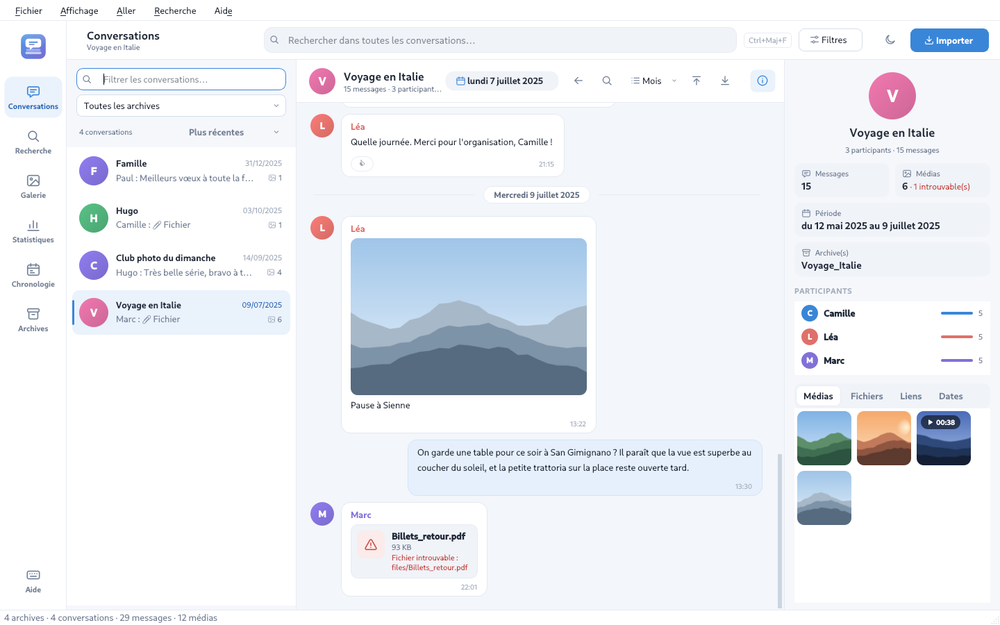

# Telegram Archive Explorer

Bibliothèque personnelle de conversations Telegram exportées en HTML, pour Debian 13.
Fonctionnement 100 % local : aucune connexion à Telegram ni à Internet.

> **Version 1.0 : les 5 étapes de la feuille de route sont terminées.** Parseur
> fiable, interface graphique, moteur de recherche, bibliothèque multi-archives,
> galerie multimédia, statistiques et chronologie avancée.



Interface en thème clair ou sombre (Ctrl+Maj+D), avec barre latérale de navigation et
recherche globale mise en avant. Système de design et détail de la refonte :
[docs/rapport-refonte-graphique.md](docs/rapport-refonte-graphique.md).

## Installation par paquet .deb (Debian 13)

Téléchargez le fichier `.deb` de la [dernière version](https://github.com/nouhailler/telegramor/releases/latest), puis :

```bash
sudo apt install ./telegram-archive-explorer_1.2.0_all.deb
```

L'application apparaît dans le menu (« Telegram Archive Explorer ») et se lance
aussi avec la commande `telegram-archive-explorer`. Les dépendances (PySide6,
BeautifulSoup, lxml) sont installées par `apt` ; la lecture vidéo intégrée est
recommandée et installée par défaut. Pour reconstruire le paquet depuis les
sources : `./packaging/build_deb.sh` (résultat dans `dist/`).

## Installation depuis les sources (Debian 13)

```bash
sudo apt install python3 python3-venv python3-pip \
                 python3-pyside6.qtwidgets python3-pyside6.qtsvg
# facultatif, police recommandée pour l'interface :
sudo apt install fonts-inter
# facultatif, pour lire les vidéos dans l'application :
sudo apt install python3-pyside6.qtmultimedia python3-pyside6.qtmultimediawidgets
./install.sh              # ou ./install.sh --raccourci pour l'ajouter au menu
```

`install.sh` crée un environnement virtuel `.venv` (avec accès aux paquets
système, pour réutiliser le PySide6 de Debian), installe `requirements.txt`
puis exécute les tests.

## Utilisation

```bash
./run.sh                  # interface graphique
```

Menu **Fichier → Importer un dossier d'export…** (Ctrl+O), puis choisir le
dossier `ChatExport_…` produit par Telegram Desktop. Un rapport d'importation
s'affiche à la fin. Réimporter le même dossier remplace ses messages, sans
doublon.

| Action | Raccourci |
|---|---|
| Importer un dossier / des fichiers HTML | Ctrl+O / Ctrl+Shift+O |
| Bibliothèque des archives | Ctrl+L |
| Galerie multimédia | Ctrl+M |
| Galerie : copier la sélection vers un dossier | Ctrl+Maj+C |
| Statistiques | Ctrl+Maj+S |
| Jour précédent / suivant | Ctrl+PgPréc / Ctrl+PgSuiv (Maj : mois) |
| Chronologie (années, mois, jours) | Ctrl+T |
| Liste de tous les raccourcis | F1 |
| Rechercher une conversation par son nom | Ctrl+K |
| **Rechercher dans toutes les conversations** | Ctrl+Maj+F |
| Rechercher dans la conversation ouverte | Ctrl+F (Entrée / Maj+Entrée : précédent / suivant) |
| Recherche avancée (filtres) | Ctrl+Maj+A |
| Fermer la recherche | Échap |
| Aller à une date | Ctrl+G (ou clic sur la date affichée en haut) |
| Premier / dernier message | Ctrl+Début / Ctrl+Fin |
| Revenir après un saut (réponse, date) | Alt+← |
| Panneau d'informations | Ctrl+I |
| Zoom avant / arrière / normal | Ctrl++ / Ctrl+− / Ctrl+0 |
| Mode sombre | Ctrl+Shift+D |

- **Galerie multimédia** (Ctrl+M) : photos, vidéos, GIF et autocollants,
  fichiers, audio, liens de toute la bibliothèque ; filtres conversation,
  expéditeur, année, tri ; taille des miniatures réglable ; double-clic pour
  ouvrir, clic droit pour *aller au message* ou ouvrir le dossier.
- **Copier des médias vers un dossier** : dans la galerie, sélectionnez
  plusieurs éléments (Ctrl + clic, Maj + clic pour une plage, Ctrl+A), puis
  *Copier la sélection…* (Ctrl+Maj+C) ; *Tout copier…* prend tous les éléments
  de l'onglet avec les filtres en cours (par exemple toutes les photos de Zoé
  en 2024). Dans une conversation, le clic droit sur les onglets *Médias* et
  *Fichiers* du panneau de droite propose la même copie. Options : noms
  d'origine ou précédés de la date du message, un sous-dossier par
  conversation, date des fichiers copiés = date du message. Les fichiers de
  l'export sont seulement lus ; aucun fichier existant n'est écrasé (suffixe
  « (2) » en cas de nom déjà pris) ; les fichiers absents de l'export sont
  ignorés et signalés.
- **Statistiques** (Ctrl+Maj+S) : pour la bibliothèque, une conversation ou
  un expéditeur : messages, jours actifs, jour le plus actif, records de jours
  d'affilée et de silence, messages par mois (un clic ouvre le mois),
  par heure, par jour de la semaine, carte jour × heure, expéditeurs, médias,
  mots les plus fréquents.
- **Chronologie** : onglet *Dates* du panneau d'informations, avec années, mois
  et jours dotés d'une barre d'activité ; un clic y mène. Le jour affiché y est
  suivi pendant la lecture.
- **Plusieurs archives** : importez autant d'exports que vous voulez, dans
  n'importe quel ordre. Les messages présents dans plusieurs exports (même
  identifiant Telegram dans la même conversation) ne sont affichés et
  recherchés qu'une fois ; les exports qui se recoupent forment une seule
  conversation, dans l'ordre chronologique. Une conversation renommée entre
  deux exports est reconnue et fusionnée.
- **Bibliothèque des archives** (Ctrl+L) : état de chaque archive (OK /
  introuvable), conversations, messages, messages en commun, médias, période,
  date d'import ; actions *Réindexer*, *Vérifier l'intégrité*, *Localiser…*
  (archive déplacée ou disque externe renommé), *Renommer…*, *Rapport
  d'import*, *Retirer…* (les fichiers ne sont jamais supprimés),
  *Reconstruire l'index de recherche*.
- **Filtre par archive** au-dessus de la liste des conversations (visible dès
  qu'il y a plusieurs archives).
- **Recherche globale** : la barre en haut de la fenêtre interroge toutes
  les conversations de toutes les archives. Les résultats (conversation,
  expéditeur, date, extrait surligné, type, archive) remplacent la liste de
  gauche ; un clic ouvre la conversation sur le message, surligné, et les
  résultats restent affichés pour passer au suivant. Casse et accents sont
  ignorés (« cafe » trouve « Café »).
  Syntaxe : `"expression exacte"`, `-mot` pour exclure ; par défaut un mot
  trouve aussi ses suites (« vac » → « vacances »).
- **Filtres** (bouton « Filtres ▾ ») : conversation, archive, expéditeur,
  période, type (photos, vidéos, audio, fichiers, liens…), pièce jointe, lien,
  nom de fichier, tri (pertinence, plus récents, plus anciens). Ils
  fonctionnent aussi sans texte (« toutes les vidéos de Paul en 2024 »).
- Cliquer sur une **citation** amène au message d'origine (surligné) ;
  « ← » ou Alt+← ramène au point de départ.
- **Mois ▾** : navigation par année et par mois.
- **Clic droit** sur une bulle : copier le texte, un lien, la date, ouvrir
  le fichier ou son dossier.
- Les **photos** s'ouvrent en grand (←/→ pour naviguer, Ctrl+molette pour
  zoomer) ; les **vidéos** dans le lecteur intégré ou celui du système.
- Les fichiers manquants sont signalés dans la bulle, sans bloquer la lecture.
- **Affichage → Mon nom…** : choisir quels messages s'affichent à droite
  (détection automatique d'après vos réactions).
- Au redémarrage, l'application rouvre la dernière conversation à l'endroit
  où vous l'aviez laissée.

### Ligne de commande

```bash
./run.sh importer CHEMIN                     # rapport seul
./run.sh importer CHEMIN --enregistrer       # rapport + ajout à la bibliothèque
./run.sh importer CHEMIN --json rapport.json --messages messages.json
./run.sh --db autre.sqlite                   # utiliser une autre bibliothèque
```

La bibliothèque est stockée dans
`~/.local/share/telegram-archive-explorer/bibliotheque.sqlite`
(les médias restent dans les dossiers d'export, référencés par chemin relatif).

## Tests

```bash
.venv/bin/python -m pytest
```

129 tests : parseur (fichier de référence réel + cas synthétiques), médias,
importation (séquentielle et parallèle, résultats identiques), base SQLite,
bibliothèque multi-archives (doublons, fusion, renommage, déplacement,
intégrité, migration), moteur de recherche (dont performance sur 200 000
messages et point d'extension sémantique), statistiques, copie de médias vers un dossier, interface (rendu hors
écran).

Le fichier de référence `tests/fixtures/reference/messages.html` est une copie
d'un export réel : il n'est pas publié dans le dépôt. Sans lui, les tests qui en
dépendent sont ignorés ; pour les exécuter, placez-y un export d'une seule page
(`messages.html`) de votre choix (les valeurs attendues sont propres au fichier
d'origine).

## Performances mesurées

| Opération (100 000 messages, 100 fichiers) | Temps |
|---|---|
| Analyse HTML (8 processus en parallèle) | ≈ 21 s (71 s en séquentiel) |
| Enregistrement en bibliothèque + index plein texte | ≈ 11 s |
| Ouverture d'une conversation | < 10 ms |
| Recherche (200 000 messages, toutes combinaisons testées) | < 0,3 s |

## Architecture

```
main.py                     point d'entrée (interface ou ligne de commande)
app/        main_window.py  fenêtre principale, menus, importation
            settings.py     paramètres persistants (QSettings)
            design.py       système de design : couleurs, typographie, espacements
            icons.py        pictogrammes SVG colorés selon le thème
            styles.py       feuille de style unique (thèmes clair / sombre)
importer/                   parseur HTML, détection, médias, rapport (étape 1)
database/   db_manager.py   connexion SQLite, migrations (PRAGMA user_version)
            repositories.py écriture des imports, lectures paginées
            search_engine.py recherche FTS5 + filtres, surlignage
            semantic.py     point d'extension pour une recherche sémantique
            models.py       objets de lecture pour l'interface
services/   indexing_service.py  importation dans un thread
            media_service.py     miniatures asynchrones + cache, ouverture système
            navigation_service.py historique des sauts
            statistics_service.py calcul des statistiques
ui/         conversation_list.py, message_view.py, message_widgets.py,
            information_panel.py, media_gallery.py, media_viewer.py, formatting.py,
            global_search.py, advanced_search.py, find_bar.py, archive_library.py,
            gallery_window.py, statistics_window.py, timeline.py, export_dialog.py,
            components.py (en-têtes de fenêtre, libellés abrégés…)
tests/
docs/       ETAPE1_PARSEUR.md … ETAPE5_AVANCE.md, rapport-refonte-graphique.md
```

## Sécurité et confidentialité

- Les fichiers d'export ne sont jamais modifiés (vérifié par un test).
- Le JavaScript des exports n'est jamais exécuté ; le HTML est assaini par
  liste blanche avant stockage et affichage.
- Les chemins de médias sont lus tels quels, jamais reconstruits ; un chemin
  sortant de l'archive est signalé et non consulté.
- Seuls les liens `http(s)` et `mailto` sont ouverts dans le navigateur, et
  uniquement sur clic de l'utilisateur.
